# Anime & Manga Tracker

Учебная full-stack-платформа для каталогизации аниме и манги, ведения пользовательских списков, отслеживания прогресса, оценивания и публикации отзывов.

Проект разработан в рамках учебных лабораторных работ и собран в единое веб-приложение. Серверная часть реализована на NestJS и TypeScript, данные хранятся в PostgreSQL и доступны через Prisma ORM.

## Возможности

- каталог аниме и манги;
- фильтрация и сортировка по типу, статусу и рейтингу;
- пользовательские профили;
- списки просмотра и чтения;
- статусы, оценки, прогресс и заметки;
- отзывы на аниме и мангу;
- расчёт рейтингов на основе пользовательских оценок;
- раздел новостей;
- передача событий о новостях в реальном времени через Server-Sent Events;
- серверный рендеринг страниц через Handlebars.

## Технологии

- **Язык:** TypeScript
- **Backend:** NestJS, Express, Handlebars
- **База данных:** PostgreSQL
- **ORM и схема данных:** Prisma ORM, Prisma Migrations
- **Инфраструктура:** Docker, Docker Compose, Render
- **Обмен событиями:** Server-Sent Events, RxJS

## Архитектура

Приложение организовано по модульному принципу NestJS. Каждый основной раздел домена имеет собственный модуль, контроллер и сервис:

- `users` — пользователи и профили;
- `anime` — каталог аниме;
- `manga` — каталог манги;
- `lists` — пользовательские списки просмотра и чтения;
- `reviews` — отзывы и рекомендации;
- `news` — новости и события Server-Sent Events;
- `prisma` — подключение к базе данных.

Модель данных описана в Prisma Schema. В проекте используются связи между сущностями, внешние ключи, каскадное удаление, уникальные ограничения и индексы.

## ER-диаграмма

<p align="center">
  
</p>

## Локальный запуск

### Требования

- Node.js 22 или новее;
- npm;
- Docker и Docker Compose.

### Установка

```bash
git clone <URL-репозитория>
cd anime-manga-tracker/backend
npm install
```

Создайте файл `.env` на основе `.env.example`:

```bash
cp .env.example .env
```

### Запуск PostgreSQL

```bash
docker compose up -d
```

### Подготовка базы данных

```bash
npx prisma migrate deploy
npx prisma generate
```

### Запуск приложения

В режиме разработки:

```bash
npm run start:dev
```

После запуска приложение доступно по адресу <http://localhost:3000>.

## Полезные команды

```bash
npm run build       # сборка приложения
npm run start:prod  # запуск собранного приложения
npm run lint        # проверка и исправление стиля
npm test            # запуск тестов
npx prisma studio   # просмотр данных через Prisma Studio
```

## Структура проекта

```text
backend/
├── prisma/      # схема базы данных и миграции
├── src/         # модули, контроллеры и сервисы NestJS
├── views/       # Handlebars-шаблоны
├── public/      # статические файлы
├── package.json
└── docker-compose.yml
```

## Статус проекта

Проект является учебным. Его цель — отработать разработку серверного приложения на NestJS, проектирование реляционной модели, работу с PostgreSQL и Prisma, серверный рендеринг, контейнеризацию и обработку событий в реальном времени.

В текущей версии часть инфраструктурных решений и механизмов безопасности упрощена для учебных целей. Проект не позиционируется как production-ready система.
